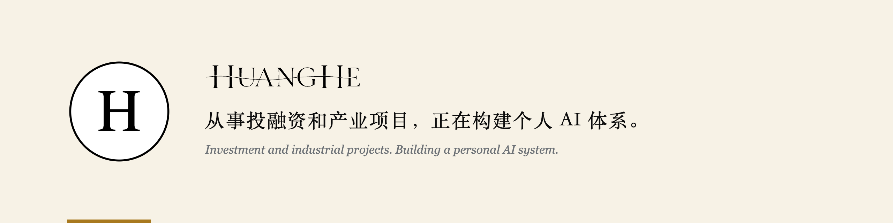

十五年上市公司履历，现在做投融资与产业项目。非程序员，用 AI 把自己这些年的工作经验建成体系，边用边升级。

### 项目

- **[gongwen-kit](https://github.com/imhuhe/gongwen-kit)**：按 GB/T 9704 生成标准 Word 公文，出稿当场机检体例、数字与文风。本地运行，MIT。

### 写作

- **玩物砺志 / Tinker & Temper**：一个非技术背景的人构建个人 AI 体系的真实过程。
  [mrhuanghe.com](https://mrhuanghe.com) · 公众号 MRHUANGHE
